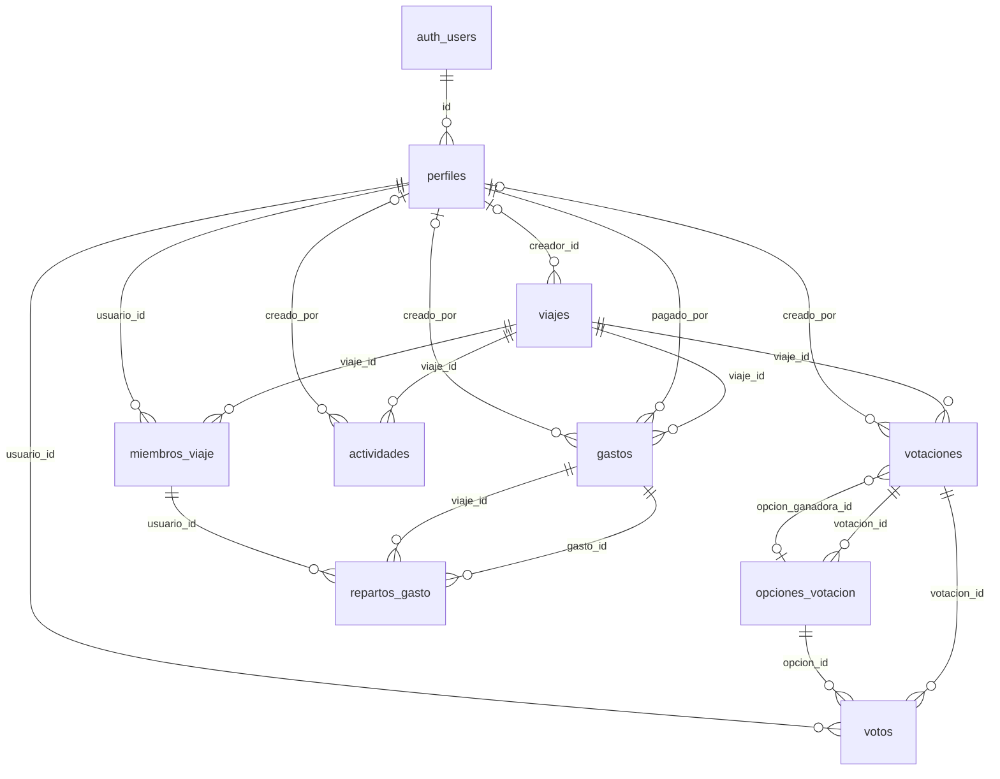

# Base de datos de TravelWrap

> Documento generado automáticamente a partir de `scripts/01_create_tables.sql` y `scripts/02_politicas_rls.sql` con `npm run docs`. No editar a mano: los cambios se perderían. Para modificar la documentación, edita los scripts SQL (los comentarios `--` junto a cada columna aparecen en la columna «Notas»).

Base de datos PostgreSQL gestionada en Supabase. La autenticación usa Supabase Auth (`auth.users`).

## Resumen

| Tabla | Columnas | RLS | Políticas |
| --- | --- | --- | --- |
| [perfiles](#perfiles) | 5 | Activada | 3 |
| [viajes](#viajes) | 14 | Activada | 4 |
| [miembros_viaje](#miembros_viaje) | 5 | Activada | 3 |
| [votaciones](#votaciones) | 10 | Activada | 3 |
| [opciones_votacion](#opciones_votacion) | 5 | Activada | 2 |
| [votos](#votos) | 5 | Activada | 4 |
| [actividades](#actividades) | 16 | Activada | 4 |
| [gastos](#gastos) | 10 | Activada | 4 |
| [repartos_gasto](#repartos_gasto) | 4 | Activada | 4 |

## Relaciones

## Tipos enumerados

| Tipo | Valores |
| --- | --- |
| `estado_viaje` | `activo`, `finalizado`, `archivado` |
| `rol_miembro` | `creador`, `miembro` |
| `tipo_votacion` | `fecha`, `destino`, `presupuesto`, `actividad`, `otro` |
| `estado_votacion` | `abierta`, `cerrada` |
| `categoria_gasto` | `comida`, `transporte`, `entradas`, `alojamiento`, `ocio`, `otros` |

## Tablas

### perfiles

**Seguridad por filas (RLS):** activada, 3 políticas

| Columna | Tipo | Obligatoria | Clave | Por defecto | Notas |
| --- | --- | --- | --- | --- | --- |
| `id` | `uuid` | Sí | PK, FK → auth.users.id (ON DELETE CASCADE) |  |  |
| `nombre` | `text` | Sí |  |  |  |
| `email` | `text` | No |  |  |  |
| `avatar_url` | `text` | No |  |  |  |
| `creado_en` | `timestamptz` | Sí |  | `now()` |  |

### viajes

**Seguridad por filas (RLS):** activada, 4 políticas

| Columna | Tipo | Obligatoria | Clave | Por defecto | Notas |
| --- | --- | --- | --- | --- | --- |
| `id` | `uuid` | Sí | PK | `gen_random_uuid()` |  |
| `creador_id` | `uuid` | No | FK → perfiles.id (ON DELETE SET NULL) |  |  |
| `nombre` | `text` | Sí |  |  |  |
| `destino` | `text` | No |  |  | Null mientras el destino está pendiente de decidir por votación |
| `descripcion` | `text` | No |  |  |  |
| `fecha_inicio` | `date` | No |  |  |  |
| `fecha_fin` | `date` | No |  |  |  |
| `imagen_portada_url` | `text` | No |  |  |  |
| `moneda` | `char(3)` | Sí |  | `'EUR'` |  |
| `presupuesto` | `numeric(12,2)` | Sí |  |  | Presupuesto estimado del viaje, en su moneda. Se fija al crearlo y se puede editar después Debe cumplir: `presupuesto >= 0` |
| `estado` | `estado_viaje` | Sí |  | `'activo'` | activo: se puede editar. archivado: solo lectura; es el único estado desde el que se puede eliminar |
| `finalizado_en` | `timestamptz` | No |  |  | Momento en que se cerró el viaje (al finalizarlo o archivarlo) |
| `token_invitacion` | `text` | Sí | UNIQUE | `replace(gen_random_uuid()::text, '-', '')` | Token del enlace/QR de invitación: uno por viaje, permanente |
| `creado_en` | `timestamptz` | Sí |  | `now()` |  |

**Restricciones**

- `viajes_fechas_validas`: `CHECK (fecha_fin IS NULL OR fecha_inicio IS NULL OR fecha_fin >= fecha_inicio)`

### miembros_viaje

**Seguridad por filas (RLS):** activada, 3 políticas

| Columna | Tipo | Obligatoria | Clave | Por defecto | Notas |
| --- | --- | --- | --- | --- | --- |
| `viaje_id` | `uuid` | Sí | PK, FK → viajes.id (ON DELETE CASCADE) |  | Al eliminar el viaje se borran sus miembros |
| `usuario_id` | `uuid` | Sí | PK, FK → perfiles.id (ON DELETE CASCADE) |  |  |
| `rol` | `rol_miembro` | Sí |  | `'miembro'` |  |
| `unido_en` | `timestamptz` | Sí |  | `now()` |  |
| `abandonado_en` | `timestamptz` | No |  |  |  |

**Índices**

- `miembros_viaje_usuario_idx` sobre (usuario_id)

### votaciones

Votaciones del grupo (fechas, destino, actividades...). La de destino se abre al crear un viaje sin destino

**Seguridad por filas (RLS):** activada, 3 políticas

| Columna | Tipo | Obligatoria | Clave | Por defecto | Notas |
| --- | --- | --- | --- | --- | --- |
| `id` | `uuid` | Sí | PK | `gen_random_uuid()` |  |
| `viaje_id` | `uuid` | Sí | FK → viajes.id (ON DELETE CASCADE) |  | Al eliminar el viaje se borran sus votaciones, y con ellas sus opciones y votos |
| `titulo` | `text` | Sí |  |  | Debe cumplir: `char_length(btrim(titulo)) BETWEEN 1 AND 200` |
| `descripcion` | `text` | No |  |  |  |
| `tipo` | `tipo_votacion` | Sí |  | `'otro'` |  |
| `estado` | `estado_votacion` | Sí |  | `'abierta'` |  |
| `opcion_ganadora_id` | `uuid` | No | FK → opciones_votacion.id (ON DELETE SET NULL) |  | Opción ganadora, que se guarda al cerrar la votación (con empate, una de las empatadas al azar) |
| `creado_por` | `uuid` | No | FK → perfiles.id (ON DELETE SET NULL) |  |  |
| `creado_en` | `timestamptz` | Sí |  | `now()` |  |
| `cerrada_en` | `timestamptz` | No |  |  |  |

**Restricciones**

- `votaciones_cierre_coherente`: `CHECK ((estado = 'cerrada') = (cerrada_en IS NOT NULL))`

**Índices**

- `votaciones_viaje_idx` sobre (viaje_id)
- `votaciones_destino_unica_idx` (único) sobre (viaje_id), solo donde `tipo = 'destino'` — Un viaje tiene como mucho una votación de destino

### opciones_votacion

Opciones entre las que se vota. Cualquier miembro puede proponer nuevas mientras la votación está abierta

**Seguridad por filas (RLS):** activada, 2 políticas

| Columna | Tipo | Obligatoria | Clave | Por defecto | Notas |
| --- | --- | --- | --- | --- | --- |
| `id` | `uuid` | Sí | PK | `gen_random_uuid()` |  |
| `votacion_id` | `uuid` | Sí | FK → votaciones.id (ON DELETE CASCADE) |  |  |
| `texto` | `text` | Sí |  |  | Debe cumplir: `char_length(btrim(texto)) BETWEEN 1 AND 100` |
| `valor_fecha` | `date` | No |  |  | Solo en las votaciones de fechas |
| `orden` | `int` | Sí |  | `0` | Posición en la lista; las propuestas nuevas van al final |

**Restricciones**

- `opciones_votacion_id_votacion_unica`: `UNIQUE (id, votacion_id)` — Permite exigir que la opción de un voto sea de su misma votación

**Índices**

- `opciones_votacion_texto_unico_idx` (único) sobre (votacion_id, lower(btrim(texto))) — No se repite una opción dentro de la misma votación (sin distinguir mayúsculas ni espacios)

### votos

Voto de un usuario en una votación. Cambiar el voto actualiza la fila; retirarlo la borra

**Seguridad por filas (RLS):** activada, 4 políticas

| Columna | Tipo | Obligatoria | Clave | Por defecto | Notas |
| --- | --- | --- | --- | --- | --- |
| `id` | `uuid` | Sí | PK | `gen_random_uuid()` |  |
| `votacion_id` | `uuid` | Sí | FK → votaciones.id (ON DELETE CASCADE) |  |  |
| `opcion_id` | `uuid` | Sí | FK → opciones_votacion.id (ON DELETE CASCADE) |  |  |
| `usuario_id` | `uuid` | Sí | FK → perfiles.id (ON DELETE CASCADE) |  |  |
| `emitido_en` | `timestamptz` | Sí |  | `now()` |  |

**Restricciones**

- `votos_un_voto_por_usuario`: `UNIQUE (votacion_id, usuario_id)` — Un voto por usuario y votación
- `votos_opcion_de_la_votacion`: `FOREIGN KEY (opcion_id, votacion_id) REFERENCES public.opciones_votacion (id, votacion_id) ON DELETE CASCADE` — La opción votada tiene que ser de la misma votación

**Índices**

- `votos_opcion_idx` sobre (opcion_id)

### actividades

**Seguridad por filas (RLS):** activada, 4 políticas

| Columna | Tipo | Obligatoria | Clave | Por defecto | Notas |
| --- | --- | --- | --- | --- | --- |
| `id` | `uuid` | Sí | PK | `gen_random_uuid()` |  |
| `viaje_id` | `uuid` | Sí | FK → viajes.id (ON DELETE CASCADE) |  |  |
| `titulo` | `text` | Sí |  |  | Debe cumplir: `char_length(btrim(titulo)) BETWEEN 1 AND 200` |
| `descripcion` | `text` | No |  |  |  |
| `fecha` | `date` | Sí |  |  |  |
| `hora_inicio` | `time` | No |  |  |  |
| `hora_fin` | `time` | No |  |  |  |
| `orden` | `int` | Sí |  | `0` |  |
| `ubicacion_nombre` | `text` | No |  |  |  |
| `latitud` | `numeric(9,6)` | No |  |  | Debe cumplir: `latitud BETWEEN -90 AND 90` |
| `longitud` | `numeric(9,6)` | No |  |  | Debe cumplir: `longitud BETWEEN -180 AND 180` |
| `lugar_externo_id` | `text` | No |  |  |  |
| `categoria` | `text` | No |  |  |  |
| `creado_por` | `uuid` | No | FK → perfiles.id (ON DELETE SET NULL) |  |  |
| `creado_en` | `timestamptz` | Sí |  | `now()` |  |
| `actualizado_en` | `timestamptz` | Sí |  | `now()` |  |

**Restricciones**

- `actividades_horas_validas`: `CHECK (hora_fin IS NULL OR hora_inicio IS NULL OR hora_fin >= hora_inicio)`

**Índices**

- `actividades_viaje_fecha_idx` sobre (viaje_id, fecha)

### gastos

Gastos compartidos del viaje. El total, el saldo de cada miembro y la liquidación se calculan siempre a partir de estas filas, así que al editar o borrar un gasto se recalculan solos

**Seguridad por filas (RLS):** activada, 4 políticas

| Columna | Tipo | Obligatoria | Clave | Por defecto | Notas |
| --- | --- | --- | --- | --- | --- |
| `id` | `uuid` | Sí | PK | `gen_random_uuid()` |  |
| `viaje_id` | `uuid` | Sí | FK → viajes.id (ON DELETE CASCADE) |  | Al eliminar el viaje se borran sus gastos, y con ellos sus repartos |
| `concepto` | `text` | Sí |  |  | Debe cumplir: `char_length(btrim(concepto)) BETWEEN 1 AND 100` |
| `importe` | `numeric(12,2)` | Sí |  |  | Importe total en la moneda del viaje Debe cumplir: `importe > 0` |
| `categoria` | `categoria_gasto` | Sí |  | `'otros'` |  |
| `pagado_por` | `uuid` | Sí | FK → perfiles.id |  | Miembro que adelanta el pago. Un perfil con gastos no se puede borrar mientras existan |
| `fecha` | `date` | Sí |  | `current_date` |  |
| `creado_por` | `uuid` | No | FK → perfiles.id (ON DELETE SET NULL) |  |  |
| `creado_en` | `timestamptz` | Sí |  | `now()` |  |
| `actualizado_en` | `timestamptz` | Sí |  | `now()` |  |

**Restricciones**

- `gastos_id_viaje_unico`: `UNIQUE (id, viaje_id)` — Permite exigir que los repartos sean de miembros del mismo viaje que el gasto
- `gastos_pagado_por_un_miembro`: `FOREIGN KEY (viaje_id, pagado_por) REFERENCES public.miembros_viaje (viaje_id, usuario_id)` — Quien paga tiene que ser miembro del viaje

**Índices**

- `gastos_viaje_fecha_idx` sobre (viaje_id, fecha DESC, creado_en DESC) — Historial de gastos del viaje, del más reciente al más antiguo

### repartos_gasto

Parte de un gasto que le corresponde a cada miembro. Las partes deben sumar el importe del gasto: lo comprueba el backend al guardar, porque la base de datos no puede exigirlo fila a fila

**Seguridad por filas (RLS):** activada, 4 políticas

| Columna | Tipo | Obligatoria | Clave | Por defecto | Notas |
| --- | --- | --- | --- | --- | --- |
| `gasto_id` | `uuid` | Sí | PK, FK → gastos.id (ON DELETE CASCADE) |  |  |
| `viaje_id` | `uuid` | Sí | FK → gastos.viaje_id (ON DELETE CASCADE) |  |  |
| `usuario_id` | `uuid` | Sí | PK, FK → miembros_viaje.usuario_id |  |  |
| `importe` | `numeric(12,2)` | Sí |  |  | Debe cumplir: `importe >= 0` |

**Restricciones**

- `repartos_gasto_del_gasto`: `FOREIGN KEY (gasto_id, viaje_id) REFERENCES public.gastos (id, viaje_id) ON DELETE CASCADE` — Al borrar el gasto se borran sus repartos
- `repartos_gasto_de_un_miembro`: `FOREIGN KEY (viaje_id, usuario_id) REFERENCES public.miembros_viaje (viaje_id, usuario_id)` — Solo se reparte entre miembros del viaje

**Índices**

- `repartos_gasto_miembro_idx` sobre (viaje_id, usuario_id)

## Seguridad (RLS)

### Funciones

| Función | Parámetros | Devuelve | Se ejecuta con permisos de | Ejecutable por | Descripción |
| --- | --- | --- | --- | --- | --- |
| `marcar_actualizado_en` |  | `trigger` | quien la llama |  |  |
| `es_miembro` | `p_viaje_id uuid` | `boolean` | su propietario (SECURITY DEFINER) |  |  |
| `es_creador` | `p_viaje_id uuid` | `boolean` | su propietario (SECURITY DEFINER) |  |  |
| `es_editable` | `p_viaje_id uuid` | `boolean` | su propietario (SECURITY DEFINER) |  | Un viaje solo admite contenido nuevo mientras está activo: al cerrarlo o archivarlo queda de solo lectura. Las tablas con contenido del viaje (gastos, tareas, actividades...) deben exigirla en sus políticas de escritura |
| `viaje_de_votacion` | `p_votacion_id uuid` | `uuid` | su propietario (SECURITY DEFINER) |  | Viaje al que pertenece una votación (lo usan las políticas de opciones y votos) |
| `puede_votar` | `p_votacion_id uuid` | `boolean` | su propietario (SECURITY DEFINER) |  | Se pueden proponer opciones y votar si eres miembro del viaje, el viaje está activo y la votación sigue abierta |
| `unirse_con_invitacion` | `p_token text` | `jsonb` | su propietario (SECURITY DEFINER) | authenticated |  |
| `crear_viaje` | `p_nombre text, p_destino text, p_fecha_inicio date, p_fecha_fin date, p_presupuesto numeric` | `jsonb` | su propietario (SECURITY DEFINER) | authenticated | Crea un viaje y añade a quien lo crea como miembro con rol creador, en una sola operación. Es SECURITY DEFINER para poder crear el perfil si falta (el login por email no lo crea). Un viaje sin destino (destino null) queda pendiente y se abre su votación de destino. Devuelve { estado }: sin_sesion \| ok (con viaje) |
| `crear_votacion` | `p_viaje_id uuid, p_titulo text, p_descripcion text, p_tipo public.tipo_votacion, p_opciones jsonb` | `jsonb` | quien la llama | authenticated | Crea una votación con sus opciones iniciales en una sola operación: si falla una opción, no se crea nada. Es SECURITY INVOKER: se aplican las mismas políticas RLS que a un insert directo en las tablas. p_opciones es una lista JSON de { texto, valor_fecha }; el orden de la lista es el de las opciones. Devuelve { estado }: no_existe \| no_activo \| ok (con votacion_id) |
| `cerrar_votacion` | `p_viaje_id uuid, p_votacion_id uuid` | `jsonb` | quien la llama | authenticated | Cierra una votación y guarda la opción ganadora: la más votada o, si hay empate, una de las empatadas al azar. En la votación de destino fija además el destino del viaje, todo en una sola operación. Solo la cierra el creador del viaje, con el viaje activo y cuando han votado todos sus miembros (RF9). Es SECURITY INVOKER (se aplican las políticas RLS). Devuelve { estado }: no_existe \| no_creador \| no_activo \| ya_cerrada \| faltan_votos \| ok (con opcion_ganadora_id, hubo_empate y destino) |
| `crear_gasto` | `p_viaje_id uuid, p_concepto text, p_importe numeric, p_categoria public.categoria_gasto, p_pagado_por uuid, p_fecha date, p_participantes uuid[]` | `jsonb` | quien la llama | authenticated | Registra un gasto y lo reparte a partes iguales entre los participantes en una sola operación: si falla una parte, no se guarda nada. Las partes se calculan en céntimos y los céntimos que sobran se reparten uno a uno entre los primeros participantes, así que siempre suman el importe del gasto. Es SECURITY INVOKER: se aplican las mismas políticas RLS que a un insert directo en las tablas. Devuelve { estado }: no_existe \| no_activo \| no_miembro \| ok (con gasto_id) |

### Políticas por tabla

#### perfiles

| Política | Operación | Rol | USING (qué filas puede ver o modificar) | WITH CHECK (qué filas puede escribir) |
| --- | --- | --- | --- | --- |
| `perfiles_select` | SELECT | authenticated | `true` |  |
| `perfiles_insert` | INSERT | authenticated |  | `id = auth.uid()` |
| `perfiles_update` | UPDATE | authenticated | `id = auth.uid()` | `id = auth.uid()` |

#### viajes

| Política | Operación | Rol | USING (qué filas puede ver o modificar) | WITH CHECK (qué filas puede escribir) |
| --- | --- | --- | --- | --- |
| `viajes_select` | SELECT | authenticated | `public.es_miembro(id) OR creador_id = auth.uid()` |  |
| `viajes_insert` | INSERT | authenticated |  | `creador_id = auth.uid()` |
| `viajes_update` | UPDATE | authenticated | `public.es_creador(id) AND estado <> 'archivado'` | `public.es_creador(id)` |
| `viajes_delete` | DELETE | authenticated | `public.es_creador(id) AND estado = 'archivado'` |  |

#### miembros_viaje

| Política | Operación | Rol | USING (qué filas puede ver o modificar) | WITH CHECK (qué filas puede escribir) |
| --- | --- | --- | --- | --- |
| `miembros_viaje_select` | SELECT | authenticated | `public.es_miembro(viaje_id) OR usuario_id = auth.uid()` |  |
| `miembros_viaje_insert_creador` | INSERT | authenticated |  | `usuario_id = auth.uid() AND rol = 'creador' AND EXISTS (SELECT 1 FROM public.viajes v WHERE v.id = viaje_id AND v.creador_id = auth.uid())` |
| `miembros_viaje_update_propio` | UPDATE | authenticated | `usuario_id = auth.uid()` | `usuario_id = auth.uid()` |

#### votaciones

| Política | Operación | Rol | USING (qué filas puede ver o modificar) | WITH CHECK (qué filas puede escribir) |
| --- | --- | --- | --- | --- |
| `votaciones_select` | SELECT | authenticated | `public.es_miembro(viaje_id)` |  |
| `votaciones_insert` | INSERT | authenticated |  | `creado_por = auth.uid() AND tipo <> 'destino' AND estado = 'abierta' AND public.es_miembro(viaje_id) AND public.es_editable(viaje_id)` |
| `votaciones_update` | UPDATE | authenticated | `public.es_creador(viaje_id) AND public.es_editable(viaje_id)` | `public.es_creador(viaje_id)` |

#### opciones_votacion

| Política | Operación | Rol | USING (qué filas puede ver o modificar) | WITH CHECK (qué filas puede escribir) |
| --- | --- | --- | --- | --- |
| `opciones_votacion_select` | SELECT | authenticated | `public.es_miembro(public.viaje_de_votacion(votacion_id))` |  |
| `opciones_votacion_insert` | INSERT | authenticated |  | `public.puede_votar(votacion_id)` |

#### votos

| Política | Operación | Rol | USING (qué filas puede ver o modificar) | WITH CHECK (qué filas puede escribir) |
| --- | --- | --- | --- | --- |
| `votos_select` | SELECT | authenticated | `public.es_miembro(public.viaje_de_votacion(votacion_id))` |  |
| `votos_insert` | INSERT | authenticated |  | `usuario_id = auth.uid() AND public.puede_votar(votacion_id)` |
| `votos_update` | UPDATE | authenticated | `usuario_id = auth.uid() AND public.puede_votar(votacion_id)` | `usuario_id = auth.uid() AND public.puede_votar(votacion_id)` |
| `votos_delete` | DELETE | authenticated | `usuario_id = auth.uid() AND public.puede_votar(votacion_id)` |  |

#### actividades

| Política | Operación | Rol | USING (qué filas puede ver o modificar) | WITH CHECK (qué filas puede escribir) |
| --- | --- | --- | --- | --- |
| `actividades_select` | SELECT | authenticated | `public.es_miembro(viaje_id)` |  |
| `actividades_insert` | INSERT | authenticated |  | `creado_por = auth.uid() AND public.es_miembro(viaje_id) AND public.es_editable(viaje_id)` |
| `actividades_update` | UPDATE | authenticated | `public.es_miembro(viaje_id) AND public.es_editable(viaje_id)` | `public.es_miembro(viaje_id) AND public.es_editable(viaje_id)` |
| `actividades_delete` | DELETE | authenticated | `public.es_miembro(viaje_id) AND public.es_editable(viaje_id)` |  |

#### gastos

| Política | Operación | Rol | USING (qué filas puede ver o modificar) | WITH CHECK (qué filas puede escribir) |
| --- | --- | --- | --- | --- |
| `gastos_select` | SELECT | authenticated | `public.es_miembro(viaje_id)` |  |
| `gastos_insert` | INSERT | authenticated |  | `creado_por = auth.uid() AND public.es_miembro(viaje_id) AND public.es_editable(viaje_id)` |
| `gastos_update` | UPDATE | authenticated | `public.es_miembro(viaje_id) AND public.es_editable(viaje_id)` | `public.es_miembro(viaje_id) AND public.es_editable(viaje_id)` |
| `gastos_delete` | DELETE | authenticated | `public.es_miembro(viaje_id) AND public.es_editable(viaje_id)` |  |

#### repartos_gasto

| Política | Operación | Rol | USING (qué filas puede ver o modificar) | WITH CHECK (qué filas puede escribir) |
| --- | --- | --- | --- | --- |
| `repartos_gasto_select` | SELECT | authenticated | `public.es_miembro(viaje_id)` |  |
| `repartos_gasto_insert` | INSERT | authenticated |  | `public.es_miembro(viaje_id) AND public.es_editable(viaje_id)` |
| `repartos_gasto_update` | UPDATE | authenticated | `public.es_miembro(viaje_id) AND public.es_editable(viaje_id)` | `public.es_miembro(viaje_id) AND public.es_editable(viaje_id)` |
| `repartos_gasto_delete` | DELETE | authenticated | `public.es_miembro(viaje_id) AND public.es_editable(viaje_id)` |  |
