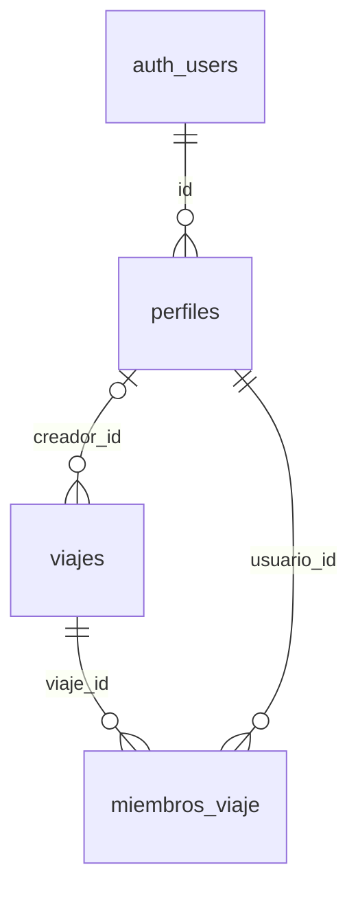

# Base de datos de TravelWrap

> Documento generado automáticamente a partir de `scripts/01_create_tables.sql` y `scripts/02_politicas_rls.sql` con `npm run docs`. No editar a mano: los cambios se perderían. Para modificar la documentación, edita los scripts SQL (los comentarios `--` junto a cada columna aparecen en la columna «Notas»).

Base de datos PostgreSQL gestionada en Supabase. La autenticación usa Supabase Auth (`auth.users`).

## Resumen

| Tabla | Columnas | RLS | Políticas |
| --- | --- | --- | --- |
| [perfiles](#perfiles) | 5 | Activada | 3 |
| [viajes](#viajes) | 14 | Activada | 4 |
| [miembros_viaje](#miembros_viaje) | 5 | Activada | 3 |

## Relaciones

## Tipos enumerados

| Tipo | Valores |
| --- | --- |
| `estado_viaje` | `activo`, `finalizado`, `archivado` |
| `rol_miembro` | `creador`, `miembro` |

## Tablas

### perfiles

**Seguridad por filas (RLS):** activada, 3 políticas

| Columna | Tipo | Obligatoria | Clave | Por defecto | Notas |
| --- | --- | --- | --- | --- | --- |
| `id` | `uuid` | Sí | PK, FK → auth.users.id (ON DELETE CASCADE) |  |  |
| `nombre` | `text` | Sí |  |  |  |
| `email` | `text` | No |  |  |  |
| `avatar_url` | `text` | No |  |  |  |
| `creado_en` | `timestamptz` | Sí |  | `now()` |  |

### viajes

**Seguridad por filas (RLS):** activada, 4 políticas

| Columna | Tipo | Obligatoria | Clave | Por defecto | Notas |
| --- | --- | --- | --- | --- | --- |
| `id` | `uuid` | Sí | PK | `gen_random_uuid()` |  |
| `creador_id` | `uuid` | No | FK → perfiles.id (ON DELETE SET NULL) |  |  |
| `nombre` | `text` | Sí |  |  |  |
| `destino` | `text` | No |  |  | Null mientras el destino está pendiente de decidir por votación |
| `descripcion` | `text` | No |  |  |  |
| `fecha_inicio` | `date` | No |  |  |  |
| `fecha_fin` | `date` | No |  |  |  |
| `imagen_portada_url` | `text` | No |  |  |  |
| `moneda` | `char(3)` | Sí |  | `'EUR'` |  |
| `presupuesto` | `numeric(12,2)` | Sí |  |  | Presupuesto estimado del viaje, en su moneda. Se fija al crearlo y se puede editar después Debe cumplir: `presupuesto >= 0` |
| `estado` | `estado_viaje` | Sí |  | `'activo'` |  |
| `finalizado_en` | `timestamptz` | No |  |  |  |
| `token_invitacion` | `text` | Sí | UNIQUE | `replace(gen_random_uuid()::text, '-', '')` | Token del enlace/QR de invitación: uno por viaje, permanente |
| `creado_en` | `timestamptz` | Sí |  | `now()` |  |

**Restricciones**

- `viajes_fechas_validas`: `CHECK (fecha_fin IS NULL OR fecha_inicio IS NULL OR fecha_fin >= fecha_inicio)`

### miembros_viaje

**Seguridad por filas (RLS):** activada, 3 políticas

| Columna | Tipo | Obligatoria | Clave | Por defecto | Notas |
| --- | --- | --- | --- | --- | --- |
| `viaje_id` | `uuid` | Sí | PK, FK → viajes.id (ON DELETE CASCADE) |  |  |
| `usuario_id` | `uuid` | Sí | PK, FK → perfiles.id (ON DELETE CASCADE) |  |  |
| `rol` | `rol_miembro` | Sí |  | `'miembro'` |  |
| `unido_en` | `timestamptz` | Sí |  | `now()` |  |
| `abandonado_en` | `timestamptz` | No |  |  |  |

**Índices**

- `miembros_viaje_usuario_idx` sobre (usuario_id)

## Seguridad (RLS)

### Funciones

| Función | Parámetros | Devuelve | Se ejecuta con permisos de | Ejecutable por | Descripción |
| --- | --- | --- | --- | --- | --- |
| `es_miembro` | `p_viaje_id uuid` | `boolean` | su propietario (SECURITY DEFINER) |  |  |
| `es_creador` | `p_viaje_id uuid` | `boolean` | su propietario (SECURITY DEFINER) |  |  |
| `unirse_con_invitacion` | `p_token text` | `jsonb` | su propietario (SECURITY DEFINER) | authenticated | Unirse a un viaje con su token de invitación. Es SECURITY DEFINER porque quien se une todavía no es miembro y las políticas no le dejan leer el viaje ni insertarse en miembros_viaje. Devuelve { estado }: sin_sesion \| no_existe \| viaje_no_activo \| ok (con viaje y miembro) |

### Políticas por tabla

#### perfiles

| Política | Operación | Rol | USING (qué filas puede ver o modificar) | WITH CHECK (qué filas puede escribir) |
| --- | --- | --- | --- | --- |
| `perfiles_select` | SELECT | authenticated | `true` |  |
| `perfiles_insert` | INSERT | authenticated |  | `id = auth.uid()` |
| `perfiles_update` | UPDATE | authenticated | `id = auth.uid()` | `id = auth.uid()` |

#### viajes

| Política | Operación | Rol | USING (qué filas puede ver o modificar) | WITH CHECK (qué filas puede escribir) |
| --- | --- | --- | --- | --- |
| `viajes_select` | SELECT | authenticated | `public.es_miembro(id) OR creador_id = auth.uid()` |  |
| `viajes_insert` | INSERT | authenticated |  | `creador_id = auth.uid()` |
| `viajes_update` | UPDATE | authenticated | `public.es_creador(id)` | `public.es_creador(id)` |
| `viajes_delete` | DELETE | authenticated | `public.es_creador(id)` |  |

#### miembros_viaje

| Política | Operación | Rol | USING (qué filas puede ver o modificar) | WITH CHECK (qué filas puede escribir) |
| --- | --- | --- | --- | --- |
| `miembros_viaje_select` | SELECT | authenticated | `public.es_miembro(viaje_id) OR usuario_id = auth.uid()` |  |
| `miembros_viaje_insert_creador` | INSERT | authenticated |  | `usuario_id = auth.uid() AND rol = 'creador' AND EXISTS (SELECT 1 FROM public.viajes v WHERE v.id = viaje_id AND v.creador_id = auth.uid())` |
| `miembros_viaje_update_propio` | UPDATE | authenticated | `usuario_id = auth.uid()` | `usuario_id = auth.uid()` |
