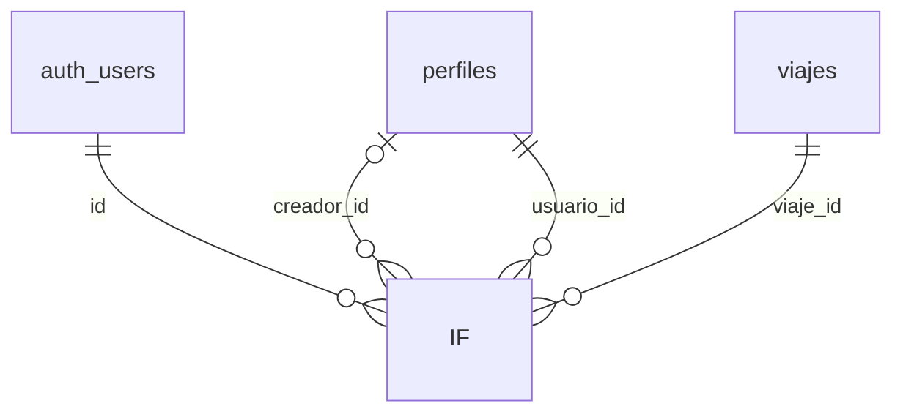

# Base de datos de TravelWrap

> Documento generado automáticamente a partir de `scripts/01_create_tables.sql` y `scripts/02_politicas_rls.sql` con `npm run docs`. No editar a mano: los cambios se perderían. Para modificar la documentación, edita los scripts SQL (los comentarios `--` junto a cada columna aparecen en la columna «Notas»).

Base de datos PostgreSQL gestionada en Supabase. La autenticación usa Supabase Auth (`auth.users`).

## Resumen

| Tabla | Columnas | RLS | Políticas |
| --- | --- | --- | --- |
| [IF](#if) | 5 | No activada | 0 |
| [IF](#if) | 14 | No activada | 0 |
| [IF](#if) | 5 | No activada | 0 |

## Relaciones

## Tablas

### IF

2. TABLAS

**Seguridad por filas (RLS):** no activada

| Columna | Tipo | Obligatoria | Clave | Por defecto | Notas |
| --- | --- | --- | --- | --- | --- |
| `id` | `uuid` | Sí | PK, FK → auth.users.id (ON DELETE CASCADE) |  |  |
| `nombre` | `text` | Sí |  |  |  |
| `email` | `text` | No |  |  |  |
| `avatar_url` | `text` | No |  |  |  |
| `creado_en` | `timestamptz` | Sí |  | `now()` |  |

### IF

**Seguridad por filas (RLS):** no activada

| Columna | Tipo | Obligatoria | Clave | Por defecto | Notas |
| --- | --- | --- | --- | --- | --- |
| `id` | `uuid` | Sí | PK | `gen_random_uuid()` |  |
| `creador_id` | `uuid` | No | FK → perfiles.id (ON DELETE SET NULL) |  |  |
| `nombre` | `text` | Sí |  |  |  |
| `destino` | `text` | No |  |  | Null mientras el destino está pendiente de decidir por votación |
| `descripcion` | `text` | No |  |  |  |
| `fecha_inicio` | `date` | No |  |  |  |
| `fecha_fin` | `date` | No |  |  |  |
| `imagen_portada_url` | `text` | No |  |  |  |
| `moneda` | `char(3)` | Sí |  | `'EUR'` |  |
| `presupuesto` | `numeric(12,2)` | Sí |  |  | Presupuesto estimado del viaje, en su moneda. Se fija al crearlo y se puede editar después Debe cumplir: `presupuesto >= 0` |
| `estado` | `estado_viaje` | Sí |  | `'activo'` |  |
| `finalizado_en` | `timestamptz` | No |  |  |  |
| `token_invitacion` | `text` | Sí | UNIQUE | `replace(gen_random_uuid()::text, '-', '')` | Token del enlace/QR de invitación: uno por viaje, permanente |
| `creado_en` | `timestamptz` | Sí |  | `now()` |  |

**Restricciones**

- `viajes_fechas_validas`: `CHECK (fecha_fin IS NULL OR fecha_inicio IS NULL OR fecha_fin >= fecha_inicio)`

### IF

**Seguridad por filas (RLS):** no activada

| Columna | Tipo | Obligatoria | Clave | Por defecto | Notas |
| --- | --- | --- | --- | --- | --- |
| `viaje_id` | `uuid` | Sí | PK, FK → viajes.id (ON DELETE CASCADE) |  |  |
| `usuario_id` | `uuid` | Sí | PK, FK → perfiles.id (ON DELETE CASCADE) |  |  |
| `rol` | `rol_miembro` | Sí |  | `'miembro'` |  |
| `unido_en` | `timestamptz` | Sí |  | `now()` |  |
| `abandonado_en` | `timestamptz` | No |  |  |  |

## Seguridad (RLS)

### Funciones

| Función | Parámetros | Devuelve | Se ejecuta con permisos de | Ejecutable por | Descripción |
| --- | --- | --- | --- | --- | --- |
| `es_miembro` | `p_viaje_id uuid` | `boolean` | su propietario (SECURITY DEFINER) |  | 1. FUNCIONES AUXILIARES |
| `es_creador` | `p_viaje_id uuid` | `boolean` | su propietario (SECURITY DEFINER) |  |  |
| `unirse_con_invitacion` | `p_token text` | `jsonb` | su propietario (SECURITY DEFINER) | authenticated | 6. FUNCIÓN UNIRSE CON INVITACIÓN |
| `crear_viaje` | `p_nombre text, p_destino text, p_fecha_inicio date, p_fecha_fin date, p_presupuesto numeric` | `jsonb` | su propietario (SECURITY DEFINER) | authenticated | 7. FUNCIÓN CREAR VIAJE Crea un viaje y añade a quien lo crea como miembro con rol creador, en una sola operación. Es SECURITY DEFINER para poder crear el perfil si falta (el login por email no lo crea). Un viaje sin destino (destino null) queda pendiente de decidir el destino por votación. Devuelve { estado }: sin_sesion \| ok (con viaje) |

### Políticas por tabla
